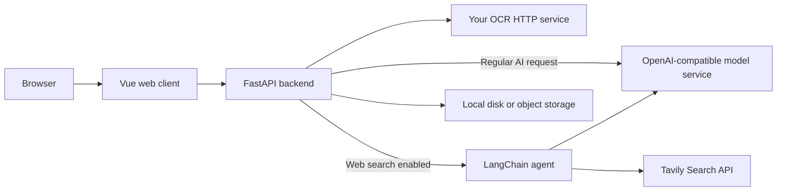

# DocuCraft

English | [简体中文](README.md)

DocuCraft is an open-source web document workspace for AI-assisted writing, web search, OCR, Word/PDF export, and PDF editing. It consists of a Vue 3/Vite web client and a Python/FastAPI backend. Web search uses a LangChain agent to orchestrate model tool calls and Tavily web search. It is designed for people and teams who want to self-host the document service and choose their own OCR engine.

[](https://github.com/zhe-w12/iscan/actions/workflows/ci.yml)
[](LICENSE)

> Production OCR connects only to the self-hosted HTTP OCR service that you configure. The project does not include Baidu OCR, Tesseract, or another fallback engine. If the OCR service is unavailable, recognition requests return an error; the rest of the web application remains available.

## Features

- **AI writing and editing:** chat, draft, continue, proofread, rewrite, shorten, expand, and summarize. Model settings live on the backend; the web client does not store model credentials.
- **Scan recognition:** the backend sends uploaded images to your OCR HTTP endpoint and returns reviewable text and tables. OCR coordinates and table geometry can be used to preserve layout.
- **Document export:** export AI documents as DOCX, PDF, or Markdown. Scans can be exported as image-faithful documents or editable tables.
- **PDF editing:** preview PDFs in the browser, erase content, add or draw signatures, and save an edited copy.
- **Browser history:** some conversations and file history are stored in the current browser. Server-side files use local storage or an object store configured by the operator.

## Architecture



| Directory | Responsibility |
| --- | --- |
| `frontend/` | Web interface, browser-side image preparation, PDF editor, and API client |
| `backend/` | FastAPI, OCR adapter, AI requests, LangChain web search, document generation, file storage, and downloads |
| `deploy/` | Nginx example for static web hosting |
| `docs/` | User, developer, and operator guides |

The web client never calls OCR or AI providers directly. Scan images go from the backend to `OCR_ENDPOINT`; AI conversation text goes from the backend to the configured model service, and search queries are also sent to Tavily when web search is enabled. Review the [data flow and privacy notes](docs/architecture.md) and use endpoints you trust.

## Technology stack

| Layer | Technology |
| --- | --- |
| Web client | Vue 3, Vite, JavaScript |
| API service | Python 3.13, FastAPI |
| Regular AI chat | The backend calls an OpenAI-compatible Chat Completions API with `httpx` |
| AI web search | LangChain 1.x agent (`langchain`, `langchain-openai`) with the Tavily tool (`langchain-tavily`) |
| OCR | Operator-configured HTTP OCR service; production uses the `generic_http` provider |

## Quick start: local development

### Requirements

- Python 3.13
- Node.js 22 and npm
- Windows, Linux, or macOS
- A reachable OCR HTTP service for real recognition. Without one, development can use the mock provider.

### 1. Configure the environment

Create `.env` in the repository root. The development defaults use mock OCR and local file storage:

Linux/macOS:

```sh
cp backend/.env.example .env
```

Windows PowerShell:

```powershell
Copy-Item backend/.env.example .env
```

You can keep the defaults for the first run. To enable AI writing, fill in `AI_API_KEY` and the model settings in the repository-root `.env` file. Web search also requires `TAVILY_API_KEY`; restart the backend, then enable “Web search” in the assistant composer. Docker deployments must rebuild the backend image after adding dependencies. Keep real credentials on your machine or server; never commit them.

### 2. Start the backend

Windows PowerShell:

```powershell
Set-Location backend
py -3.13 -m venv .venv
.\.venv\Scripts\Activate.ps1
python -m pip install -r requirements.txt
python run.py
```

Linux/macOS:

```sh
cd backend
python3.13 -m venv .venv
. .venv/bin/activate
python -m pip install -r requirements.txt
python run.py
```

The backend listens at `http://127.0.0.1:5000` by default. Check `http://127.0.0.1:5000/health` for its health status.

### 3. Start the web client

Open another terminal at the repository root:

```sh
cd frontend
npm ci
npm run dev
```

Open the URL printed by Vite. Development uses the local backend on port `5000` by default. Set `VITE_API_BASE_URL` to use a different API address, then restart or rebuild the web client. This is a public API address; do not put credentials in it.

## Connect a self-hosted OCR service

Development defaults to `OCR_PROVIDER=mock`. Mock results do not measure the accuracy of a real engine. To connect your service, set the backend environment variables:

```dotenv
OCR_PROVIDER=generic_http
OCR_ENDPOINT=https://ocr.example.com/recognize
OCR_API_KEY=replace-with-your-service-key
```

Set `OCR_API_KEY` only if your service requires Bearer authentication. The production Compose file fixes the provider to `generic_http` and requires `OCR_ENDPOINT`. The backend sends the image as the `image` field in `multipart/form-data` and accepts text, positioned words, and table data. See the [self-hosted OCR guide](docs/self-hosted-ocr.en.md) for the full response schema, networking, and troubleshooting.

## Production deployment

A production deployment includes the static web client, FastAPI backend, your OCR service, and persistent file storage. Follow the [backend deployment guide](backend/README.en.md#docker-deployment) for environment configuration, Compose, HTTPS reverse proxy, storage backups, and health checks. The [`deploy/`](deploy/README.md) directory contains an Nginx example for the web client.

Make sure the backend can reach the OCR endpoint. In a container, `127.0.0.1` refers to that container or host, not another machine. Use a private network address or HTTPS domain for a remote OCR service. Do not expose an unprotected backend port to the public internet.

## Configuration and troubleshooting

- OCR settings, JSON response formats, coordinates, and table fields: [self-hosted OCR guide](docs/self-hosted-ocr.en.md)
- Test corpora, CER, and table accuracy: [OCR benchmarking](docs/ocr-benchmark.en.md)
- Directory structure, request flow, and data boundaries: [architecture](docs/architecture.md)
- Backend variables, API, and deployment: [backend guide](backend/README.en.md)
- Web development and build: [frontend guide](frontend/README.md)
- Nginx static hosting: [deployment example](deploy/README.md)

For common failures, first check `/health`, the API URL used by the browser, backend logs, and network connectivity. For OCR errors, verify `OCR_ENDPOINT`, authentication, request fields, and OCR service logs. Do not include API keys or real scans in public issues or logs.

## Contributing and license

Bug reports, documentation fixes, and code contributions are welcome. Read the [contribution guide](CONTRIBUTING.md) and [security policy](SECURITY.md) before submitting changes. This project follows the [Code of Conduct](CODE_OF_CONDUCT.md) and is released under the [MIT License](LICENSE). Dependencies, fonts, OCR engines, and AI models may have separate licenses and terms; review them before deployment.

