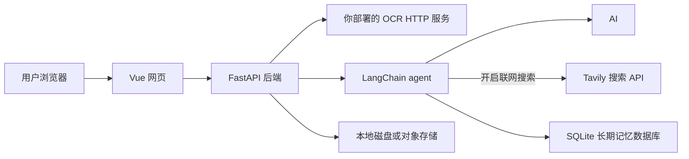

# DocuCraft

简体中文 | [English](README.en.md)

DocuCraft 是一个开源的网页文档工作台，提供 AI 写作、联网搜索、跨对话长期记忆、扫描件文字识别、Word/PDF 导出和 PDF 编辑功能。项目由 Vue 3/Vite 网页前端和 Python/FastAPI 后端组成；LangChain agent 负责 AI 工具编排，长期记忆保存在服务端 SQLite 数据库。

[](https://github.com/zhe-w12/iscan/actions/workflows/ci.yml)
[](LICENSE)

> DocuCraft 的 OCR 生产环境只连接你配置的自建 HTTP OCR 服务。项目不内置百度 OCR、Tesseract 或其他备用识别引擎；如果 OCR 服务不可用，识别请求会返回错误，扫描功能本身仍可使用于开发 mock 和非 OCR 文档工作流。

## 功能一览

- **AI 写作与修改**：支持规划 agent 先讨论目录和章节安排，用户确认后由写作 agent 生成正文；也支持聊天、续写、润色、改写、缩写、扩写和总结。模型通过后端配置；网页代码不保存模型密钥。
- **扫描件识别**：上传图片，由后端把图像发送到你部署的 OCR HTTP 接口，生成可校对的文本与表格。支持 OCR 坐标和表格结构，以便还原布局。
- **文档导出**：将 AI 文档导出为 DOCX、PDF 或 Markdown；扫描件可生成保留原图版式的文档，以及可编辑的表格文档。
- **PDF 编辑**：在浏览器中预览 PDF、擦除内容、添加或手写签名，并另存编辑后的 PDF。
- **浏览器本地记录**：部分对话和文件历史保存在当前浏览器。服务端文件可使用本地存储或按部署配置使用对象存储。

## 系统组成



| 组件 | 主要职责 |
| --- | --- |
| `frontend/` | 网页界面、浏览器图片准备、PDF 编辑和 API 调用 |
| `backend/` | FastAPI、OCR 服务适配、LangChain AI tools、SQLite 长期记忆、文档生成、文件存储与下载 |
| `deploy/` | Nginx 静态网页服务配置示例 |
| `docs/` | 面向用户、开发者和部署者的详细指南 |

网页不会直接连接 OCR 或 AI 服务。扫描图片由后端发送到 `OCR_ENDPOINT`；AI 对话文本由后端发送到你配置的模型服务，开启联网搜索时搜索词也会发送到 Tavily。部署时请阅读[数据流与隐私说明](docs/architecture.md)，并只使用你信任的服务端点。

## 技术栈

| 层 | 技术 |
| --- | --- |
| 网页 | Vue 3、Vite、JavaScript |
| API 服务 | Python 3.13、FastAPI |
| AI agent 与模型 | LangChain 1.x（`langchain`、`langchain-openai`）调用配置的 OpenAI-compatible 模型 |
| AI 联网搜索 | LangChain agent 按需调用 Tavily 工具（`langchain-tavily`） |
| 长期记忆 | Python SQLite，保存在 `STORAGE_DIR/assistant_memory.sqlite3` |
| OCR | 部署者配置的 HTTP OCR 服务；生产环境使用 `generic_http` provider |

## 快速开始：本地开发

### 环境要求

- Python 3.13
- Node.js 22 和 npm
- Windows、Linux 或 macOS
- 使用真实识别时，还需一个可从后端访问的 OCR HTTP 服务。没有 OCR 服务时，开发环境可使用 mock 识别响应。

### 1. 准备环境变量

在仓库根目录创建 `.env`。开发配置默认使用 mock OCR 和本地文件存储：

Linux/macOS：

```sh
cp backend/.env.example .env
```

Windows PowerShell：

```powershell
Copy-Item backend/.env.example .env
```

首次运行时可先保持默认值。要启用 AI 写作，请填写仓库根目录 `.env` 中的 `AI_API_KEY` 及模型服务设置。启用联网搜索还需配置 `TAVILY_API_KEY`，重启后端后在助手输入框打开“联网搜索”。Docker 部署新增依赖后需重新构建后端镜像。真实密钥只写入服务器或本机的 `.env`，不要提交到 Git。

### 2. 启动后端

Windows PowerShell：

```powershell
Set-Location backend
py -3.13 -m venv .venv
.\.venv\Scripts\Activate.ps1
python -m pip install -r requirements.txt
python run.py
```

Linux/macOS：

```sh
cd backend
python3.13 -m venv .venv
. .venv/bin/activate
python -m pip install -r requirements.txt
python run.py
```

后端默认监听 `http://127.0.0.1:5000`。访问 `http://127.0.0.1:5000/health` 可查看健康状态。

### 3. 启动网页

另开一个终端，在仓库根目录运行：

```sh
cd frontend
npm ci
npm run dev
```

使用 Vite 显示的地址打开网页。开发环境默认通过本机 `5000` 端口访问 API。如需指定其他后端地址，可设置 `VITE_API_BASE_URL` 后重新启动或构建前端。该变量是公开 API 地址，不能放密钥。

## 连接自建 OCR

开发模式默认 `OCR_PROVIDER=mock`，不会代表任何真实 OCR 引擎的识别效果。要连接自建服务，请在后端环境设置：

```dotenv
OCR_PROVIDER=generic_http
OCR_ENDPOINT=https://ocr.example.com/recognize
OCR_API_KEY=替换为服务密钥
```

`OCR_API_KEY` 仅在服务需要 Bearer 认证时填写。生产 Compose 固定使用 `generic_http`，并要求 `OCR_ENDPOINT` 已设置。接口会以 `multipart/form-data` 的 `image` 字段发送图像，并接受文字、坐标词语和表格数据。完整字段、示例、网络配置和故障排查请看[自建 OCR 接入指南](docs/self-hosted-ocr.md)。

## 生产部署

生产部署包括网页静态文件、FastAPI 后端、你自己的 OCR 服务和持久化文件目录。请从[部署指南](backend/README.md#docker-部署)开始，按顺序完成环境变量、Compose、HTTPS 反向代理、存储备份和健康检查。网页服务示例见 [`deploy/`](deploy/README.md)。

请确保后端可访问 OCR 服务地址；容器网络中的 `127.0.0.1` 指向后端容器或主机自身，不能用于指代另一台机器。跨主机连接应使用内网地址或 HTTPS 域名。公网不应直接暴露未受保护的后端端口。

## 配置和排错

- OCR 配置、接口 JSON 格式、坐标与表格字段：[自建 OCR 接入指南](docs/self-hosted-ocr.md)
- OCR 测试样例、CER 与表格准确率：[OCR 效果评估](docs/ocr-benchmark.md)
- 项目目录、请求流程和数据边界：[系统架构](docs/architecture.md)
- 后端变量、API 和部署：[后端指南](backend/README.md)
- 网页开发与构建：[前端指南](frontend/README.md)
- Nginx 静态网页配置：[部署示例](deploy/README.md)

常见排查顺序：先检查 `/health`；再检查浏览器使用的 API 地址、后端日志和网络连通性；OCR 错误时检查 `OCR_ENDPOINT`、认证方式、请求体字段和 OCR 服务日志。不要在 issue 或日志中公开 API 密钥或真实扫描件。

## 贡献与许可

欢迎提交错误报告、文档改进和代码贡献。开始前请阅读[贡献指南](CONTRIBUTING.md)和[安全政策](SECURITY.md)。本项目遵循[行为准则](CODE_OF_CONDUCT.md)，并以 [MIT License](LICENSE) 发布。项目依赖、字体、OCR 引擎和 AI 模型可能有各自的许可证和使用条款，请在部署前单独确认。

