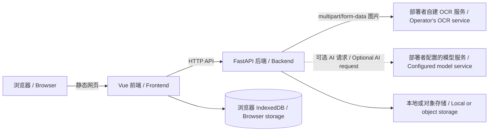

# DocuCraft 架构与数据流 | Architecture and data flow

本文面向第一次阅读代码的用户、开发者和部署者，说明仓库结构、前后端边界、扫描请求和数据经过的位置。DocuCraft 的主应用由两个模块组成：`frontend/` 网页端和 `backend/` API 服务。

This guide explains the repository layout, frontend/backend boundary, scan request flow, and data locations for users, contributors, and operators. The main DocuCraft application has two modules: the `frontend/` web client and the `backend/` API service.

## 目录结构 | Repository layout

| 路径 | 职责 |
| --- | --- |
| `frontend/` | Vue 3 网页界面、浏览器图片准备、PDF 编辑、离线静态资源和前端测试。 |
| `backend/` | FastAPI 路由、OCR provider、图像与文档处理、文件存储、后端测试和 Docker 配置。 |
| `deploy/` | Nginx 静态网页服务示例。 |
| `docs/` | 用户指南、开发说明、OCR 对接和效果评估文档。 |
| `.github/workflows/` | 前后端检查和成对部署包构建流程。 |
| `CONTRIBUTING.md` / `SECURITY.md` / `CODE_OF_CONDUCT.md` | 贡献流程、安全漏洞报告和社区行为准则。 |

`frontend/` 与 `backend/` 之间通过 HTTP API 通信。OCR 类型定义、自建服务 HTTP 适配器、provider 选择和识别协调逻辑位于 `backend/app/services/ocr.py`。API 请求与响应模型在 `backend/app/models.py`。

## 主要组件 | Main components

| 组件 | 做什么 | 不负责什么 |
| --- | --- | --- |
| 网页前端 | 显示扫描、编辑、导出和 AI 工作区；准备上传图片；调用后端 API。 | 不运行服务端 OCR、不持有 OCR/AI 密钥、不直接调用模型。 |
| FastAPI 后端 | 校验请求、调用 provider、还原文档、存储文件、执行导出。 | 不托管用户实际选择的 OCR 模型；不替用户配置外部服务。 |
| 自建 OCR HTTP 服务 | 接收后端上传的图像，返回识别文本和可选坐标/表格。 | 不由本仓库自动部署；需要用户自行运行并提供可达的 URL。 |
| AI 模型服务 | 在用户启用 AI 功能后，根据后端配置处理对话内容。 | 密钥不能放在网页代码或浏览器构建环境中。 |
| 文件存储 | 保存后端生成或接收的文件，可为本地磁盘或配置的对象存储。 | 不等同于浏览器本地历史。 |

## 扫描请求流程 | Scan request flow

1. 用户在网页选择图片；浏览器端做尺寸、格式和 OCR 输入准备。
2. 前端将文件发送到 `POST /api/v1/documents/convert`。
3. 后端检查上传限制，从配置中选择 OCR provider，并把图像发送到 `OCR_ENDPOINT`。
4. 自建 OCR 服务返回段落、定位词语和/或表格结构。
5. 后端归一化识别结果，生成可编辑文档和预览文件，并保存文件及元数据。
6. 前端接收文档信息，显示识别内容供用户检查、修改和导出。

1. The browser prepares the selected image and sends it to `POST /api/v1/documents/convert`.
2. FastAPI validates limits, selects the configured OCR provider, and sends the image to `OCR_ENDPOINT`.
3. The self-hosted OCR service returns paragraphs and optional positioned words or tables.
4. The backend normalizes the result, creates editable documents/previews, and stores the files and metadata.
5. The frontend renders the result for review, editing, and export.

生产 Compose 固定使用 `OCR_PROVIDER=generic_http`，缺少 `OCR_ENDPOINT` 时不启动。识别错误不会改用百度、Tesseract 或其他后备 OCR。开发环境中的 `mock` 只用于前端和流程开发，不会执行真实图像识别。

Production Compose fixes `OCR_PROVIDER=generic_http` and requires `OCR_ENDPOINT`. A failed request does not switch to Baidu, Tesseract, or another OCR engine. Development `mock` mode exercises the UI and request flow without recognizing real images.

## 数据位置和隐私 | Data locations and privacy

- **网页代码**会被浏览器下载，前端配置不是秘密。不要在 `VITE_*` 变量、静态资源或前端源码中放服务凭据。
- **扫描图片**从浏览器发送到 DocuCraft 后端，再由后端发送至部署者配置的 OCR 服务。使用真实用户文件前，部署者应确认 OCR 服务器、网络链路和日志的访问控制。
- **AI 对话**在使用 AI 功能时经由后端发给后端配置的模型服务。请在部署前阅读模型服务商的数据处理和保留条款。
- **浏览器历史**有一部分保存在当前浏览器的 IndexedDB 或本地存储中；清除网站数据会影响本机历史。它不会自动同步到其他设备。
- **后端文件**保存在后端配置的本地目录或对象存储中。生产环境需自行设置访问权限、保留周期和备份。
- **日志**应避免记录 API 密钥、完整上传内容、识别文本和其他个人资料。公开 issue 中只能使用已授权并脱敏的例子。

- **Web code** is downloaded to the browser, so frontend settings are public. Never place credentials in `VITE_*` variables, static assets, or client source code.
- **Scan images** travel from the browser to the DocuCraft backend, then to the operator-configured OCR service. Before using real user documents, review access controls for the OCR host, network path, and logs.
- **AI conversations** are sent through the backend to its configured model service when AI features are used. Review that provider's data handling and retention terms before deployment.
- **Browser history** is partly stored in IndexedDB or local storage for the current browser profile. Clearing site data affects that local history; it does not automatically sync across devices.
- **Backend files** are stored in the configured local directory or object store. Operators must set access controls, retention, and backups for production.
- **Logs** should not contain API keys, full uploads, recognized text, or personal data. Use authorized, sanitized examples in public issues.

## 文档导出 | Document exports

- AI 文档由后端生成 Word/PDF；Markdown 可由浏览器本地导出。
- 扫描件原图版保留页面外观，适用于需要和原始扫描页对照的场景。
- 可编辑扫描件使用 OCR 文字和表格结构生成 Word 文档。输出质量取决于 OCR 是否返回足够准确的文本、坐标和表格信息。
- PDF 编辑在浏览器内处理预览和编辑操作；下载或保存副本后，用户应检查输出文件是否符合预期。

- AI documents are exported as Word/PDF by the backend; Markdown can be exported in the browser.
- Image-faithful scan exports preserve the scanned page appearance for visual comparison.
- Editable scan exports use recognized text and table structure to build a Word document. Quality depends on the accuracy of OCR text, coordinates, and table data.
- PDF preview and editing happen in the browser. Review downloaded or saved copies before relying on them.

## 部署边界 | Deployment boundary

生产服务通常包括静态网页服务、FastAPI 后端、自建 OCR 服务，以及可选的 AI 和对象存储服务。HTTPS 反向代理应负责公开入口；OCR/AI 密钥和用户数据应保存在后端或存储服务器的受限位置。网页静态目录不能包含 `.env`、用户上传文件、日志或后端数据目录。

A production setup usually includes a static web server, the FastAPI backend, a self-hosted OCR service, and optional AI/object-storage services. Use an HTTPS reverse proxy as the public entry point. Keep OCR/AI keys and user files in restricted backend or storage locations. The public web root must not contain `.env`, user uploads, logs, or backend data directories.

部署步骤与 Nginx 示例分别见[后端部署指南](../backend/README.md)和[`deploy/`](../deploy/README.md)。

See the [backend deployment guide](../backend/README.en.md) and [`deploy/`](../deploy/README.md) for deployment examples.

